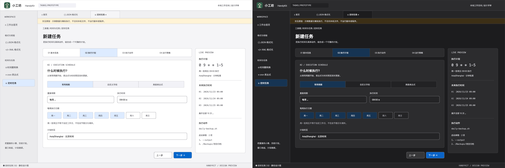

# 小工坊界面设计规范 v1.0

生效日期：2026-11-20。适用范围：正式桌面框架、首页、独立原型，以及后续所有小工具。新增页面必须同时设计浅色和深色，采用同一套语义变量。

## 设计方向

参考 macOS 的中性窗口底色、清晰的内容层级、系统字体、紧凑工具栏和蓝色交互反馈。采用不透明背景，避免大面积浅绿、渐变、低对比灰字和依赖玻璃效果的层次。这里的色值是小工坊项目标准，并非 Apple 系统动态色常量，也不承诺复刻特定 macOS 版本。

交互蓝用于主操作、选中、链接与键盘焦点；工坊绿 `#315F49` 保留在品牌图标，不能替代通用操作色。状态必须同时提供文字或图标，不能仅靠红绿区分。设计依据参见 [Apple 色彩指南](https://developer.apple.com/design/human-interface-guidelines/color)、[深色模式指南](https://developer.apple.com/design/human-interface-guidelines/dark-mode)和[无障碍指南](https://developer.apple.com/design/human-interface-guidelines/accessibility)。

[浅深色组件对照](system/preview.html) · [定时任务原型](../prototypes/tasks/index.html)



## 颜色标准

颜色以语义命名，禁止在新页面中重新定义一套局部颜色。以下值来自 `development/design-system/tokens.json`；修改标准时应同步该文件与本表。CSS 名称统一加 `--hk-` 前缀。

|语义变量|浅色|深色|
|---|---|---|
|`canvas`|`#F5F5F7`|`#1C1C1E`|
|`sidebar`|`#EBEBED`|`#242426`|
|`toolbar`|`#F0F0F2`|`#252527`|
|`surface`|`#FFFFFF`|`#2C2C2E`|
|`surface-raised`|`#FFFFFF`|`#38383A`|
|`surface-inset`|`#F2F2F7`|`#222224`|
|`field`|`#FFFFFF`|`#242426`|
|`hover`|`#E5E5EA`|`#414145`|
|`separator`|`#C9C9CE`|`#48484C`|
|`control-border`|`#85858C`|`#8E8E93`|
|`text-primary`|`#1D1D1F`|`#F5F5F7`|
|`text-secondary`|`#515157`|`#D1D1D6`|
|`text-tertiary`|`#64646B`|`#B0B0B8`|
|`text-disabled`|`#77777D`|`#8E8E93`|
|`disabled`|`#E9E9ED`|`#2E2E30`|
|`accent`|`#0066CC`|`#0A64C8`|
|`accent-hover`|`#0054A8`|`#0B70DE`|
|`accent-active`|`#00478F`|`#0857B0`|
|`accent-text`|`#005DBB`|`#64B5FF`|
|`on-accent`|`#FFFFFF`|`#FFFFFF`|
|`selection`|`#DDEBFF`|`#163453`|
|`selection-text`|`#004B9A`|`#9DCFFF`|
|`focus`|`#0066CC`|`#64B5FF`|
|`success`|`#1F6B35`|`#8AD9A0`|
|`success-bg`|`#E6F4EA`|`#173722`|
|`warning`|`#825000`|`#FFD080`|
|`warning-bg`|`#FFF3D6`|`#3C2F16`|
|`danger`|`#B42318`|`#FFB4AB`|
|`danger-bg`|`#FEEBE9`|`#432220`|
|`info`|`#005DBB`|`#9DCAFF`|
|`info-bg`|`#E8F1FD`|`#19314E`|
|`purple`|`#6941A5`|`#D5B5FF`|
|`purple-bg`|`#F1EBFA`|`#342449`|
|`code-text`|`#174B84`|`#A9D4FF`|
|`backdrop`|`rgba(0, 0, 0, 0.28)`|`rgba(0, 0, 0, 0.56)`|
|`shadow`|`0 8px 28px rgba(0, 0, 0, 0.14)`|`0 12px 36px rgba(0, 0, 0, 0.40)`|

使用规则：

- `canvas` 为主工作区底色；`sidebar` 为导航；`toolbar` 为窗口工具栏；`surface` 为卡片/表格；`surface-raised` 为浮层；`surface-inset` 为内嵌区域；`field` 为输入框。
- `text-primary` 用于标题、正文和关键值；`text-secondary` 用于标签和说明；`text-tertiary` 用于次要时间、元信息，不能用透明度继续变淡。
- `separator` 仅用于装饰性分隔；可操作控件轮廓用 `control-border`，不能把浅分隔线当作唯一的输入框边界。
- `accent` 配 `on-accent` 用于实心主按钮；正文链接用 `accent-text`。深色模式下禁止直接把亮蓝底与白字组合。
- `selection` 配 `selection-text` 用于导航、Tab 和分段选中；`focus` 用于键盘焦点。
- 成功/警告/失败/信息/辅助紫分别使用对应前景与 `*-bg` 配对。代码值用 `code-text`；日志内容保留正常文本与等宽字体，错误增加明确标签。
- 品牌图形、业务图片不通过滤镜反色。图片自身需要适配时另备资产。

## 字体、尺寸与布局

|元素|规范|
|---|---|
|系统字体|`-apple-system, BlinkMacSystemFont, "SF Pro Text", "PingFang SC", "Segoe UI", "Microsoft YaHei", sans-serif`；不下载或分发 SF 字体|
|等宽字体|`"SFMono-Regular", Menlo, Consolas, monospace`，用于 Cron、路径、参数与日志|
|字号|注释 11px；标签 12px；正文 13px；区域标题 18px；页面标题 24px|
|字重/行高|正文 400，标签 500，标题 600；正文行高 1.5；关键说明不得缩成小号装饰文字|
|间距|4px 基准；4/8/12/16/24/32px；字段间 16px，区域间 24px，页面边距优先 24–32px|
|控件|标准高度 32px，紧凑控件 28px；文字和图标共同居中；独立图标按钮必须有可访问名称|
|框架|宽屏导航基准 220px；标题栏 56px；Tab 栏 40px；窄窗口允许收缩导航，内容可滚动，禁止遮挡主要操作|
|圆角|控件 6px；卡片 8px；对话框 12px；不采用大圆角胶囊装饰所有元素|
|边框|通常 1px；输入控件采用可辨识轮廓；不靠阴影表示可点击|
|阴影|只用于对话框、菜单等浮层，使用 `shadow`；底层卡片用表面与边界区分|
|图标|16–20px，线条和视觉重量一致；选中同时改变背景/文字，避免只变细小图标|

页面结构沿用 IDE 式导航与主内容 Tab。功能分类位于侧栏，首页常用功能保持可直达。编辑任务时的步骤、右侧预览、底部操作保持稳定，不能因切换主题改变位置。

## 组件和交互状态

|状态|统一表现|
|---|---|
|默认|中性表面、正文色、明确控件边界；每个操作区域最多一个主要操作|
|悬停|普通控件 `hover`；主按钮 `accent-hover`；仅悬停变化不能承载必需信息|
|按下|主按钮 `accent-active`，保留文字对比度|
|键盘焦点|`:focus-visible` 使用 3px `focus` 外轮廓，偏移 2px；不得全局去掉 outline|
|选中|`selection` 与 `selection-text`，Tab/导航增加字重或结构标记；原生控件保留选中语义|
|禁用|`disabled` 与 `text-disabled`，保留边界；不整体降低 opacity；禁用原因另行说明|
|校验失败|`danger` 边界、明确错误文字，与字段建立关联；不只变红|
|执行中|文字说明当前状态，必要时加进度/转圈；避免只通过闪动表达，禁止重复提交|
|空态|正常可读的说明和下一步操作，不降低整个区域透明度|
|开关|开启用强调蓝，关闭用控件轮廓灰，滑块保持明确位置差异；配“启用/暂停”等文字|

危险操作应明确命名，例如“删除任务”。对话框提供取消入口；抽屉与模态层不能使焦点落在被遮挡的内容。新组件需补齐键盘操作、焦点管理和状态语义，不能仅复用颜色便声称已满足无障碍要求。

## 外观行为

顶部“外观”提供「跟随系统 / 浅色 / 深色」，默认跟随系统。显式选择在本地保存（键名 `handykit.appearance.v1`），刷新与重启保留；只有跟随系统时响应系统外观变化。存储不可用时退回当前会话，不阻断页面。窗口之间通过存储事件同步。

根节点 `data-appearance` 表示用户偏好，`data-theme` 表示解析后的浅/深色；不得用整个页面 CSS 反色。首次绘制前加载 `appearance.js`，减少闪白；正式 Tauri 外壳通过 `set_appearance` 同步原生窗口主题。各平台标题栏的实际表现仍依赖系统能力，应分别验收。

遵循 `prefers-reduced-motion`；默认过渡 160ms，减少动态效果时为 0。`prefers-contrast: more` 增强分隔与次要文字。当前采用不透明面板，不依赖背景透明或模糊才能阅读。

## 对比度与验收

以 WCAG 2.2 的普通文本 4.5:1、关键非文本控件线索 3:1 作为配色目标，参见 [文本对比度](https://www.w3.org/WAI/WCAG22/Understanding/contrast-minimum.html)与[非文本对比度](https://www.w3.org/WAI/WCAG22/Understanding/non-text-contrast.html)。装饰分隔线不等同于控件边界；11px 注释也按普通文本检查，不套用大字例外。

自动检查覆盖两主题共 94 个指定配对，包括三级文本与常用表面、状态色、主按钮、选中色、代码色、控件轮廓和焦点色。当前最小文本对比度：浅色 **4.68:1**、深色 **4.72:1**；指定控件配对最低：浅色 **3.08:1**、深色 **4.27:1**。这不代表全产品已完成 WCAG 合规审核，叠加、焦点顺序、读屏、缩放和实际系统渲染仍需人工验收。

交付新页面时检查：两种主题与跟随系统切换；重启恢复；键盘焦点与错误提示；空态/禁用/选中/执行中；长路径与中英文文本；窗口缩放和 200% 内容放大；表格、日志、抽屉和模态框；macOS/Windows/Linux 原生窗口外观。设计图是静态界面稿，不是运行 App 截图。

## 工程维护

唯一颜色与尺寸来源：`development/design-system/tokens.json`。共享组件规则：`components.css`；主题控制器：`appearance.js`。正式页面按「tokens → 布局 CSS → components」顺序加载，页面保留布局职责，不覆盖语义颜色。独立原型使用脚本生成的本地副本，不引入在线字体或 CDN。

```sh
python3 scripts/sync_design_system.py
python3 scripts/check_design_system.py
node --test scripts/test_appearance.cjs
python3 scripts/generate_tasks_designs.py --png
```

`sync_design_system.py` 生成 CSS 与独立页面副本；`check_design_system.py` 校验同步、指定配对的对比度和布局 CSS 非法硬编码颜色。静态 SVG 生成器通过同一 token 源解析颜色。品牌 SVG 原始图形不属于界面颜色硬编码禁令。

更改 token 需同步本规范、组件对照页与两主题设计图，并通过上述检查；新增语义或使用新配对时扩展对比度检查。不得通过单个页面手写十六进制颜色绕过设计标准。
