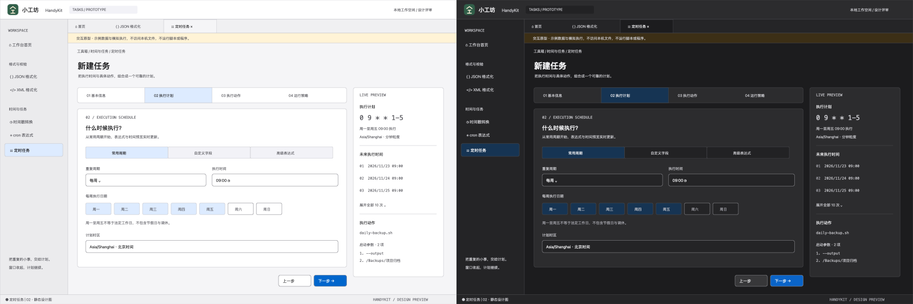
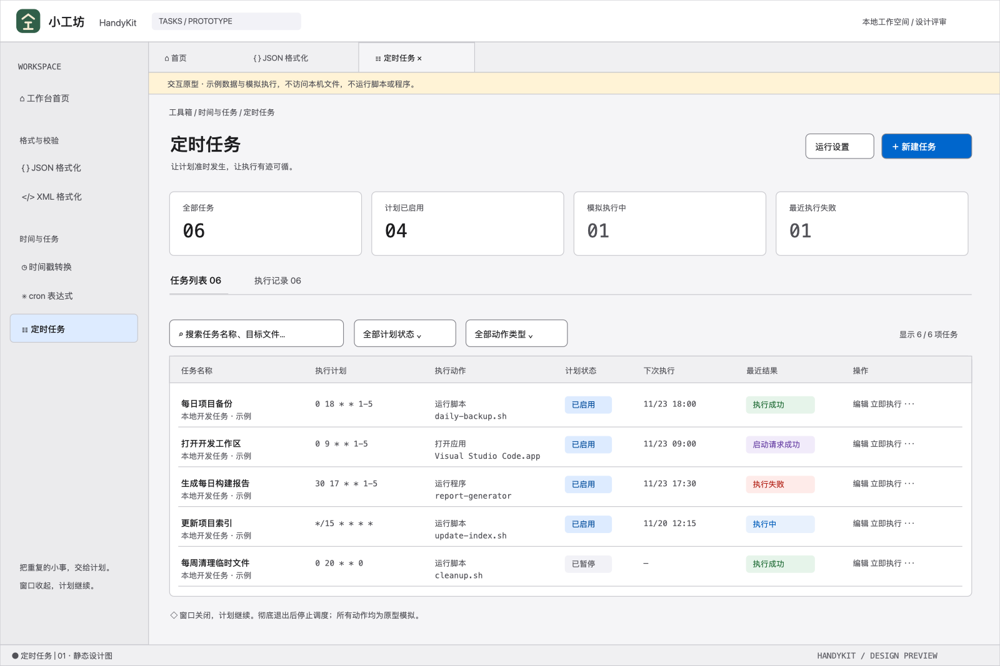
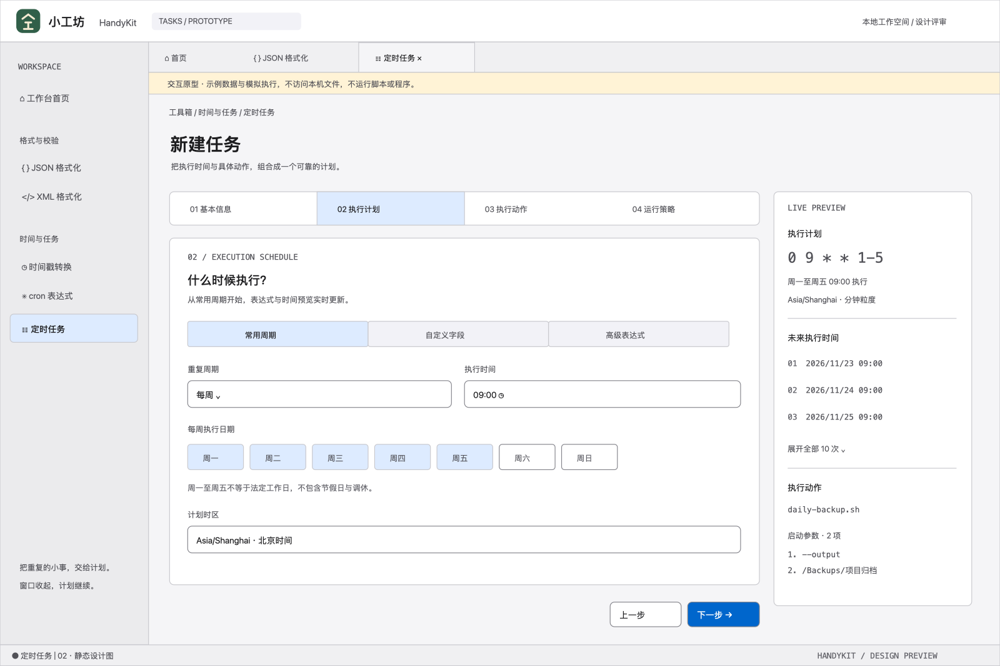
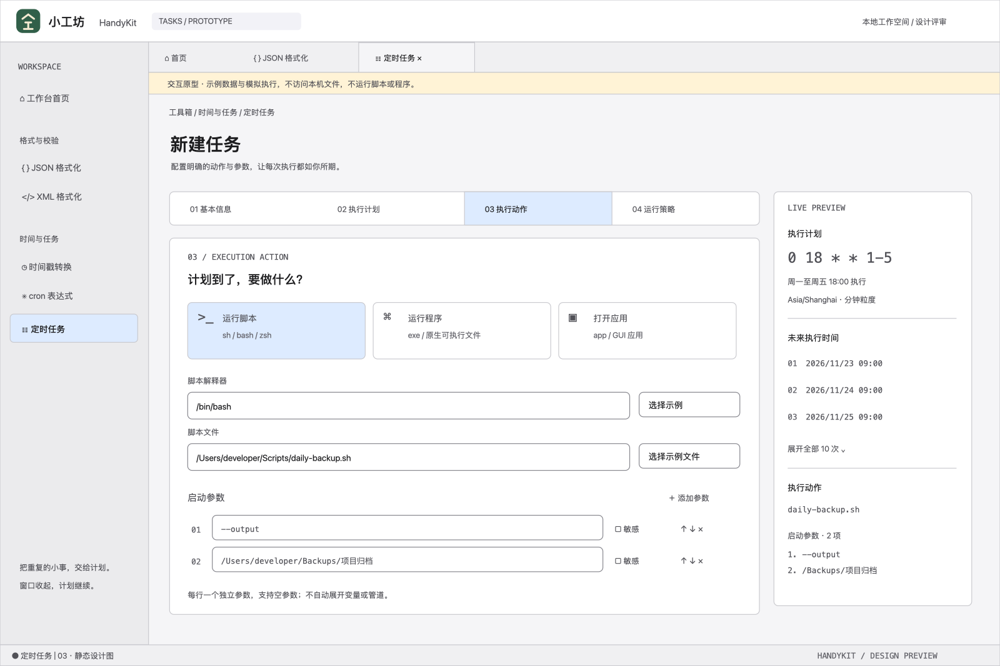
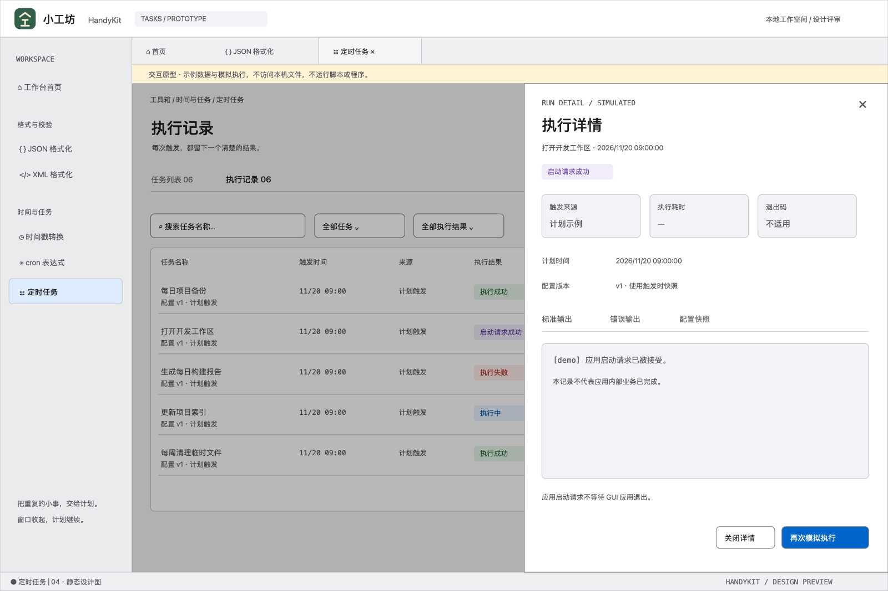

# 定时任务交互原型 v0.2

依据：[定时任务需求分析清单](../../requirements/02-定时任务调研与需求分析清单.md)。本轮是设计评审稿，尚未接入正式工具页面、Rust 调度器、执行器或数据库。

[打开可交互原型](index.html)

## 浅色与深色

顶部“外观”支持跟随系统、浅色、深色，选择在本地保存。统一遵循[界面设计规范](../../design/02-界面设计规范.md)，可查看[组件对照页](../../design/system/preview.html)。



完整设计稿：[浅色目录](designs/light/) · [深色目录](designs/dark/)，均包含列表、Cron、动作参数、执行记录四页。以下兼容路径默认展示浅色。

## 静态设计图

以下是与交互方案对应的静态界面设计稿，非运行 App 的截图；PNG 可直接查看，SVG 保留矢量源文件。

### 01 · 任务列表



区分计划启停状态和最近执行结果；展示下次时间；提供搜索、动作筛选、编辑、模拟立即执行及更多操作。

### 02 · Cron 可视化配置



常用周期、自定义字段、高级表达式三种入口；右侧保持计划说明、时区和未来执行预览。

### 03 · 动作与参数



分别配置脚本、可执行程序和应用启动。程序/解释器/参数/工作目录分开保存，参数每行一个值，可排序和标记敏感。

### 04 · 执行记录与日志详情



执行记录列表与右侧详情抽屉；标准输出、错误输出和配置快照分别展示。GUI 的“启动请求成功”与受管任务的“执行成功”使用不同语义。

## 页面与状态

|页面/状态|可操作内容|
|---|---|
|任务列表|搜索与筛选、启停、查看详情、复制、删除、草稿继续、运行设置。|
|基本信息|任务名称与说明、目标平台。|
|执行计划|常用周期、自定义五字段、高级表达式、时区、实时生成与未来十次时间预览。|
|执行动作|脚本/程序/app 切换、示例文件选择、解释器、启动模式、独立参数、环境变量、工作目录。|
|运行策略|展示建议重叠/遗漏/重试策略；受管模式支持配置超时。|
|保存与校验|必填名称、Cron 格式、路径形式、缺解释器、环境变量名与超时范围检查；保存暂停或启用。|
|任务详情|查看保存后的配置、版本、下一次时间及结果；编辑与模拟执行。|
|执行记录|按任务、结果和名称筛选；查看 stdout/stderr 与快照。|
|模拟执行|手动点击后显示短暂执行中，再记录模拟成功；应用启动不产生退出码；重叠/并发饱和可记录跳过。|
|取消与删除|模拟任务可取消；删除停用计划但保留历史。|
|退出流程|演示继续后台、等待完成或停止后退出，不实际关闭系统应用。|
|空态和草稿|无匹配任务、无记录、未保存修改、草稿恢复、重置示例。|

常用周期支持每 N 分钟、每小时指定分钟、每天、每周多选星期、每月多选日期。自定义字段支持每个值、指定值/列表、范围、步长；无法无损回填的组合保留高级模式。

## 本轮采用的设计默认

- Unix 五字段、分钟粒度；不在此稿混入 Quartz 或秒/年份。
- 同任务重叠跳过、遗漏跳过、不自动重试。
- 全局并发初始 3；示例日志保留 30 天，单次输出 10 MB。数值仍待需求确认，不是已批准的容量指标。
- 目标平台可在基本信息切换；Windows sh 解释器有缺失状态演示。
- 应用模式不展示工作目录、环境覆盖或受管进程超时；已运行应用的参数接收能力由目标应用决定。
- 日期/星期均受限时按 Unix OR；夏令时缺失时刻跳过，重复时刻只取首次。这是原型预览规则，正式版需由 Rust 统一实现和验证。

## 模拟与持久化边界

- 页面仅在独立预览 App 中调用外观切换 IPC；任务操作不调用执行 IPC，不读取真实文件，不运行脚本、exe 或 app，也不注册系统任务。
- “选择示例文件”是原型对话框，不是真实文件选择器。
- Cron 时间预览是原型内计算，不会据此触发任务。
- 示例任务、执行记录、当前编辑草稿保存到当前浏览器或预览 App 的 localStorage；二者不与正式 App 共享存储。
- 标记敏感的参数/环境变量只保留在当前会话，持久化前清空其值；原型不提供系统凭据存储。
- 模拟超时、休眠补偿、日志容量/保留期、操作系统退出、进程树管理没有真实执行。运行策略中的不可选项用于标明本稿首版边界。
- 可通过顶部“重置示例”恢复初始数据。

## 打开与复现

直接在浏览器打开本目录 `index.html`，无需依赖安装和在线资源。

macOS 独立预览 App：

`builds/prototypes/HandyKit Tasks Prototype.app`

重新打包：

```sh
node scripts/package_tasks_prototype.mjs --offline
```

预览 App 使用独立标识 `dev.handykit.tasks.prototype` 和独立输出目录，不覆盖 `builds/darwin-arm64/HandyKit.app`。它复用现有本机 Tauri 外壳，仅用于显示设计稿。正式 App 的工具入口仍为占位页。

生成静态 SVG/PNG：

```sh
python3 scripts/generate_tasks_designs.py
# macOS 上使用 Quick Look 导出 PNG：
python3 scripts/generate_tasks_designs.py --png
```

验证 Cron 预览逻辑：

```sh
node --test scripts/test_tasks_prototype.cjs
```

## 验证记录

- JavaScript 语法检查通过。
- 9 项 Cron 预览测试通过：五字段/范围校验、无损回填、星期别名、未来十次、日期星期 OR、夏令时缺失与重复、月末不挪动、无触发组合、闰日远期预览。
- 隔离 DOM 检查通过：页面启动、新建必填校验、Cron 模式切换、参数排序与空参数、保存启用、模拟执行、日志快照、暂停、敏感值持久化边界。该检查不等同于真实浏览器排版或原生输入验收。
- 静态 PNG 设计图已渲染并查看；独立预览 App 编译及签名检查通过。
- 本机界面自动化工具启动独立 App 时超时，未取得运行截图，因此未声称完成 App 的实机点击、键盘和视觉验收。文中的图片均为静态设计稿。
